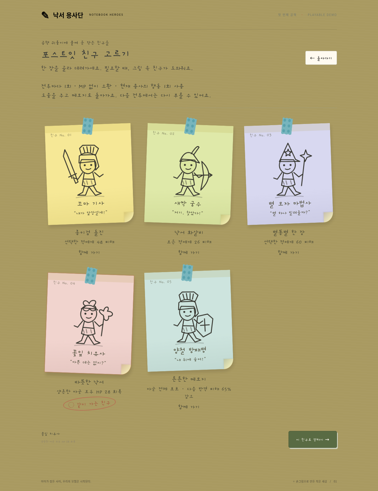
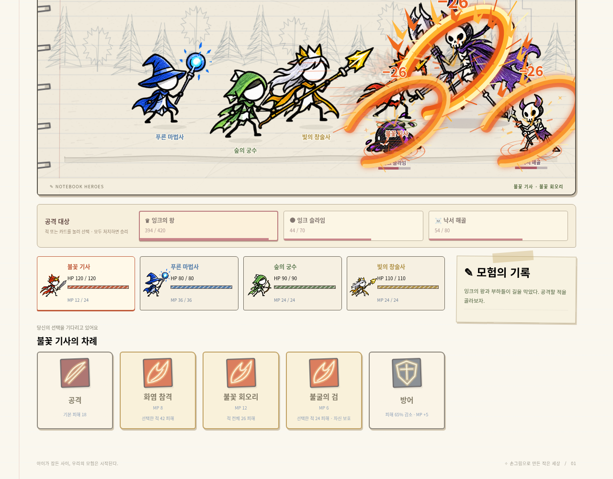
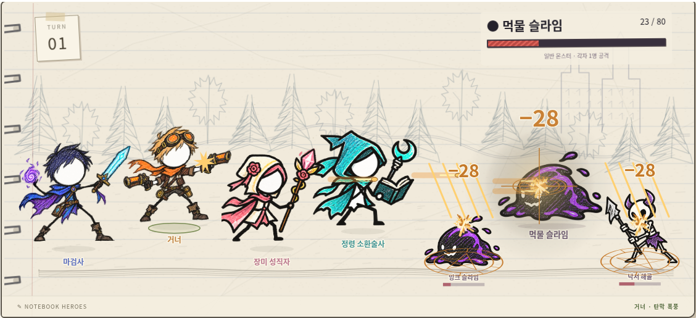
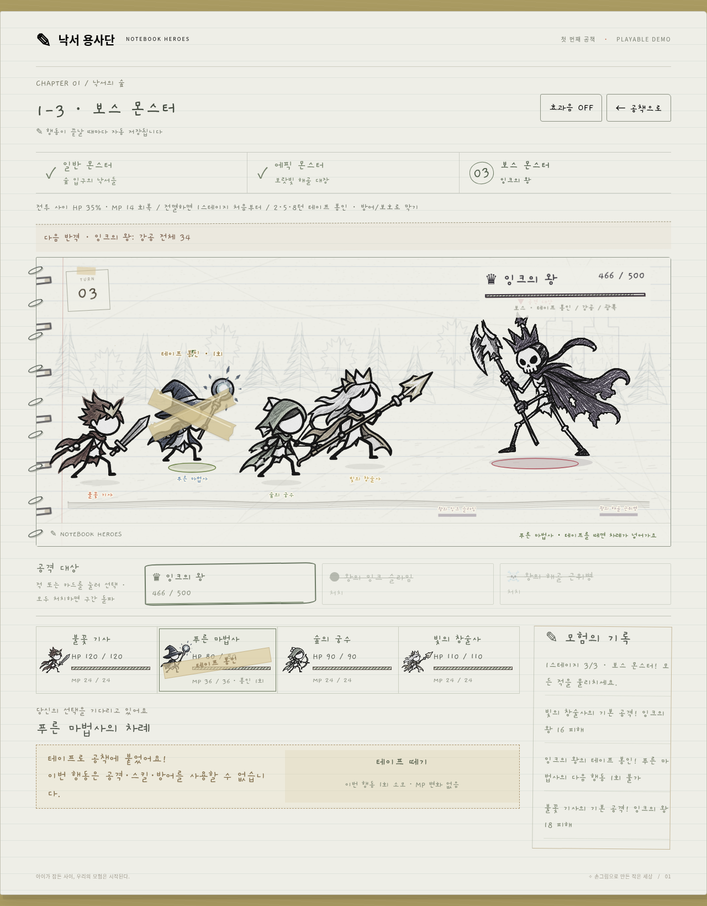
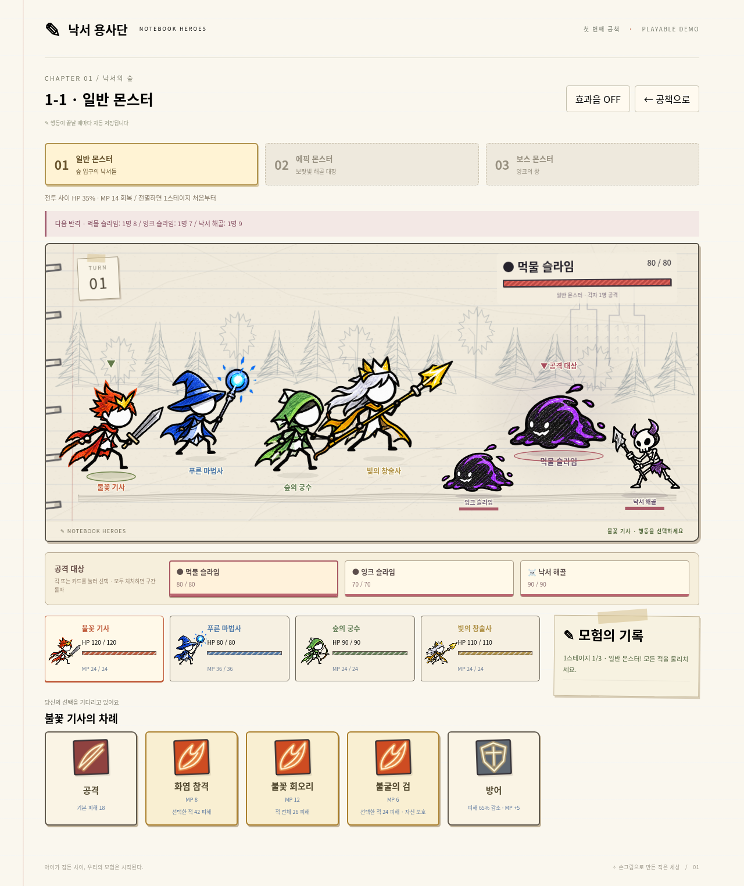
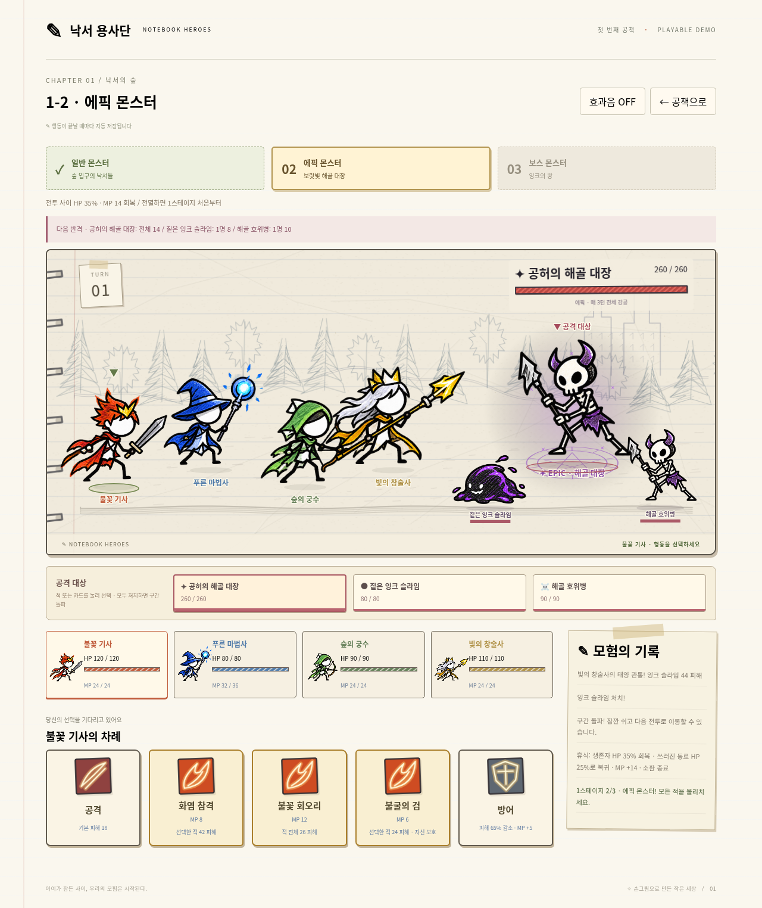
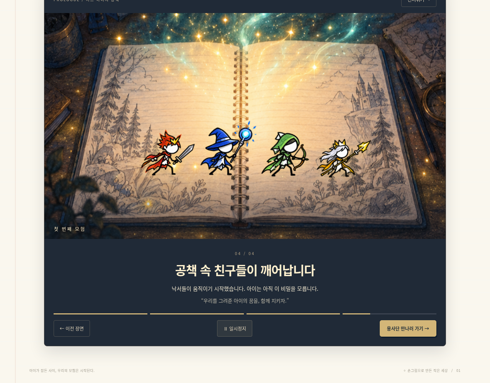
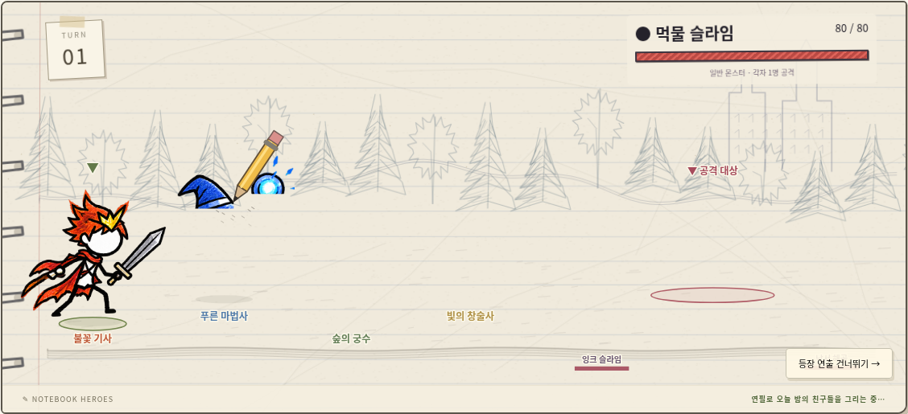
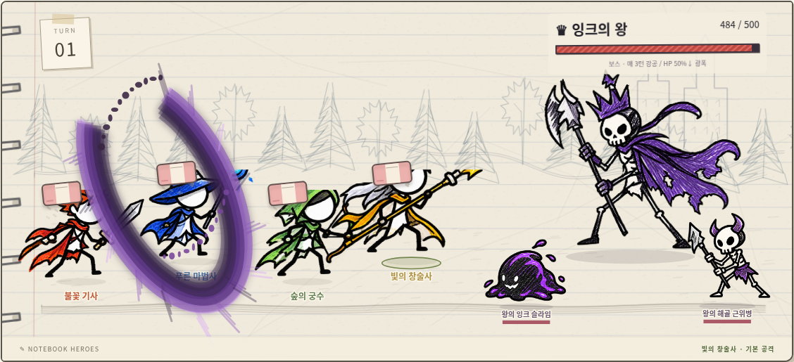
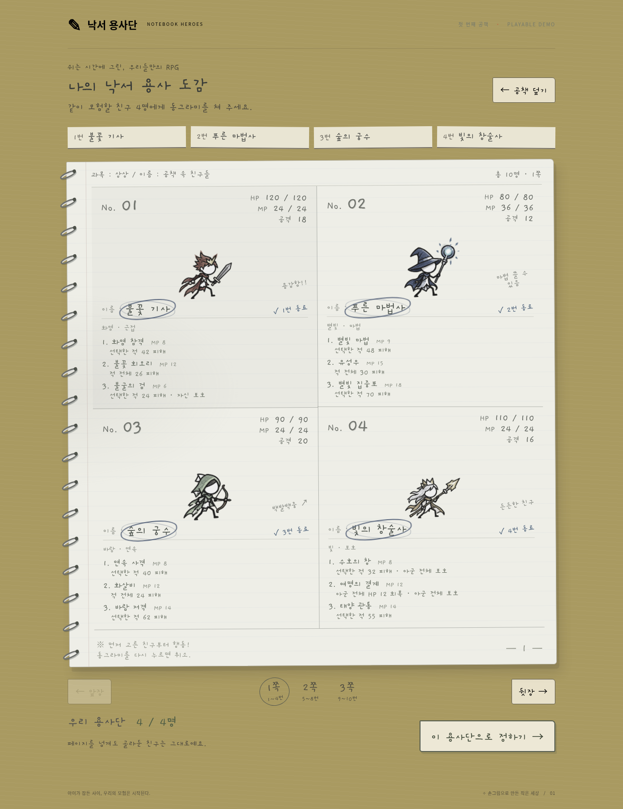

# 낙서 용사단 · Notebook Heroes

공책 속 용사들의 4인 파티 턴제 전투 데모입니다.

**[게임 ZIP 다운로드](https://github.com/WooooTae/Note_Demo/raw/refs/heads/main/release/Notebook-Heroes.zip)**

압축을 풀고 `Game.html`을 Edge 또는 Chrome으로 여세요. 설치나 인터넷 연결이 필요 없습니다.

## Unity 프로젝트

**[Unity 프로젝트 ZIP 다운로드](https://github.com/WooooTae/Note_Demo/raw/refs/heads/main/release/Notebook-Heroes-Unity.zip)**

Unity 6.0 LTS에서 열 수 있는 네이티브 C# 이식 프로토타입입니다. 10개 직업·30개 스킬, 동료 5종, 3연전, 테이프 봉인, 파일 저장을 포함합니다. ZIP은 실행 파일이 아닌 소스 프로젝트입니다. 열기·빌드 방법과 검증 제한은 [Unity 안내](unity/NotebookHeroes/README.md)를 참고하세요. 현재 환경에서는 Unity 에디터 Play와 Windows 빌드를 실행하지 못했습니다.

기존 JavaScript와 C# 전투 로직은 80개 시나리오, 4,034번의 행동/전환 결과를 비교해 일치함을 확인했습니다. .NET 8이 설치되어 있다면 다음 명령으로 재검증할 수 있습니다.

```sh
node scripts/unity-check/generate.mjs unity-fixtures.json
dotnet run --project scripts/unity-check/UnityLogicCheck.csproj -- unity/NotebookHeroes/Assets/Resources/GameData.json unity-fixtures.json
python scripts/export_unity.py
```

## 플레이

- **게임 시작**: 약 34초의 도입 컷씬을 본 뒤, 10명의 용사 중 서로 다른 4명을 고른 뒤 포스트잇 동료 한 명과 모험을 시작합니다.
- **도입 컷씬**: 혼자인 교실 → 공책에 친구를 그리는 밤 → 잠든 아이 → 깨어나는 용사들의 네 장면입니다. 카메라 이동, 밤빛, 빛 입자, 파티 용사들의 등장 동작과 자막을 사용합니다. 음성 내레이션은 없습니다.
- 컷씬은 이전·다음 장면, 일시정지, 건너뛰기를 지원합니다. 동작 줄이기 설정에서는 수동 진행으로 시작합니다. 메인 메뉴의 **이야기 다시 보기**는 저장 기록을 바꾸지 않습니다. 이어하기와 전투 재도전은 컷씬 없이 진행합니다.
- **등장과 퇴장**: 새 전투가 시작되면 약 3.4초 동안 연필이 용사와 적을 차례로 그립니다. 등장 연출은 건너뛸 수 있습니다. HP가 0이 되면 지우개가 캐릭터만 지우며, 공책 배경은 유지됩니다. 소환수의 마무리 공격과 아군 전멸에도 적용됩니다. 동작 줄이기 설정에서는 즉시 표시·제거합니다. 대상 변경이나 이어하기 때는 등장 연출을 반복하지 않습니다.
- **용사단 편성**: 스프링 공책에 연필로 나눈 네 칸에서 친구를 고릅니다. 이름에 동그라미가 쳐지면 선택된 상태이며, 다시 누르면 해제됩니다. 선택한 순서가 행동 순서입니다. 앞장·뒷장 또는 쪽 번호로 10개 직업을 둘러보세요. 페이지를 넘겨도 선택은 유지됩니다.
- **이어하기**: 마지막으로 완료한 행동까지 저장된 파티, HP, MP, 각 적의 HP, 선택 대상, 소환수, 테이프 봉인, 턴과 3연전 진행 구간을 복원합니다. 구간 클리어 직후의 저장 기록은 이어하기에서 회복 후 다음 전투로 자동 진행합니다.
- 저장 기록이 있을 때 새 모험을 시작하면 덮어쓰기 전에 확인합니다.
- 저장은 브라우저의 로컬 저장소를 사용합니다. 같은 브라우저와 같은 HTML 파일 위치에서 이용하세요. 브라우저 데이터 삭제, 시크릿 모드, 파일 이동 시 기록을 읽지 못할 수 있습니다. 저장이 차단되면 안내가 표시됩니다.

## 포스트잇 동료

메인 메뉴의 **포스트잇 친구** 또는 새 모험의 용사 편성 다음 화면에서 5종 중 한 명을 고릅니다. 전투에서도 소환 전에는 **친구 바꾸기**로 변경할 수 있습니다. 메인 메뉴에서 고른 친구는 다음 새 모험에 적용되며 진행 중인 저장 기록은 유지됩니다.

| 동료 | 소환 효과 |
| --- | --- |
| 꼬마 기사 | 선택한 적에게 48 피해 |
| 새싹 궁수 | 적 전체에 26 피해 |
| 별 모자 마법사 | 선택한 적에게 60 피해 |
| 꽃잎 치유사 | 생존 아군 전체 HP 28 회복 |
| 양철 방패병 | 아군 전체 보호: 다음 반격 피해 65% 감소, 테이프 봉인 방어 |

**포스트잇 소환**은 현재 용사의 행동 한 번을 사용하며 MP는 소비하지 않습니다. 구간별 전투마다 한 번 사용할 수 있고, 다음 전투에서 다시 충전됩니다. 테이프로 붙잡힌 용사는 소환할 수 없습니다. 동료는 포스트잇을 타고 나타나 한 번 도운 뒤 돌아가는 지원 캐릭터이며, 소환술사의 별여우와 별도로 사용할 수 있습니다. 치유는 부활시키지 않습니다.

선택 동료와 소환 사용 여부는 자동 저장됩니다(v5). 이전 저장 기록에는 꼬마 기사가 기본 배정됩니다. 보내준 참고 이미지의 메모지, 물방울무늬 테이프, 말린 모서리, 검은 낙서선을 참고해 SVG로 그렸습니다.



## 용사와 전투

10개 직업마다 스킬 3개, 총 30개를 사용할 수 있습니다. 전투에서 스킬 이름, MP 비용, 효과를 확인하고 선택하세요. 부족한 MP는 방어로 회복할 수 있습니다. 기존 이어하기에도 스킬이 바로 추가됩니다.

| 용사 | 기존 스킬 | 추가 스킬 1 | 추가 스킬 2 |
| --- | --- | --- | --- |
| 불꽃 기사 | 화염 참격: 피해 42 / MP 8 | 불꽃 회오리: 적 전체 26 / MP 12 | 불굴의 검: 피해 24 + 자신 보호 / MP 6 |
| 푸른 마법사 | 별빛 마법: 피해 48 / MP 9 | 유성우: 적 전체 30 / MP 15 | 별빛 집중포: 피해 70 / MP 18 |
| 숲의 궁수 | 연속 사격: 피해 40 / MP 8 | 화살비: 적 전체 24 / MP 12 | 바람 저격: 피해 62 / MP 14 |
| 빛의 창술사 | 수호의 창: 피해 32 + 전체 보호 / MP 8 | 여명의 결계: 전체 HP 12 회복 + 전체 보호 / MP 12 | 태양 관통: 피해 55 / MP 14 |
| 장미 성직자 | 장미의 축복: 전체 HP 30 회복 / MP 10 | 만개하는 기적: 전체 HP 45 회복 / MP 18 | 장미 가시: 피해 38 / MP 8 |
| 그림자 도적 | 그림자 쌍검: 피해 52 / MP 10 | 그림자 난무: 적 전체 28 / MP 14 | 생명 훔치기: 피해 36 + 흡수 / MP 8 |
| 정령 소환술사 | 별여우 소환: 피해 24 + 정령 3회 / MP 12 | 정령 쇄도: 피해 40 + 정령 3회 / MP 16 | 정령 결계: 전체 HP 18 회복 + 전체 보호 / MP 12 |
| 흑마법사 | 영혼 흡수: 피해 44 + 흡수 / MP 10 | 영혼 소용돌이: 적 전체 26 + 흡수 / MP 16 | 심연의 창: 피해 72 / MP 20 |
| 마검사 | 룬 블레이드: 피해 46 / MP 9 | 차원 검기: 적 전체 29 / MP 14 | 룬의 수호: 피해 27 + 자신 보호 / MP 7 |
| 거너 | 더블 트리거: 피해 46 / MP 9 | 탄막 폭풍: 적 전체 28 / MP 14 | 마탄 저격: 피해 68 / MP 17 |

흡수는 실제로 입힌 총 피해의 50%(소수점 버림)를 자신에게 회복합니다. 회복은 최대 HP를 넘지 않으며, 보호는 다음 반격 피해를 65% 줄입니다. 별여우는 지원 공격당 피해 18을 입힙니다. 광역 스킬은 살아 있는 모든 적에게 적용됩니다.

기본 공격은 MP를 소비하지 않습니다. 방어는 다음 반격 피해를 65% 줄이고 MP를 5 회복합니다. 생존 아군이 모두 행동하면 살아 있는 적들이 반격합니다. 에픽 대장과 보스는 매 3라운드 강한 전체 공격을 사용합니다. 회복은 쓰러진 아군을 부활시키지 않습니다.

## 1스테이지: 일반 → 에픽 → 보스

| 구간 | 적 / HP | 주요 패턴 |
| --- | --- | --- |
| 1-1 일반 몬스터 | 먹물 슬라임 80 · 잉크 슬라임 70 · 낙서 해골 90 | 각자 한 명 공격, 피해 8 / 7 / 9 |
| 1-2 에픽 몬스터 | 공허의 해골 대장 260 · 슬라임 80 · 해골 호위병 90 | 대장 전체 14, 매 3라운드 전체 24 / 부하 8, 10 |
| 1-3 보스 몬스터 | 잉크의 왕 500 · 슬라임 90 · 해골 근위병 100 | 2·5·8…라운드 테이프 봉인, 그 외 전체 20 / 매 3라운드 전체 34 / 부하 9, 11 |

**테이프 봉인**: 보스가 2·5·8…라운드에 자신의 공격 대신 예고된 용사 한 명을 테이프로 공책에 붙입니다. 부하들은 계속 공격합니다. 대상이 방어하거나 동료에게 보호를 받으면 막습니다. 봉인된 용사는 다음 차례에 공격·스킬·방어 대신 **테이프 떼기**로 행동 한 번을 소모합니다. MP는 변하지 않으며, 이후에는 정상 행동합니다. 봉인은 저장·복원되며 사망 시 해제됩니다. 이전 저장 형식(v1–v3)은 봉인 없이 복원됩니다.

보스 HP가 50% 이하이면 광폭화해 보스 공격에 피해 4가 추가됩니다. 화면 위에 현재 반격의 대상 범위와 피해량이 표시됩니다. 공격 중 광폭 조건을 넘으면 그 라운드 반격부터 적용됩니다.

화면의 적이나 아래 대상 카드를 눌러 공격 대상을 선택하세요. 각 구간의 적을 모두 쓰러뜨리면 퇴장 연출이 끝난 뒤 회복을 적용하고 **다음 전투로 자동 진행**합니다. 별도의 휴식 화면이나 다음 전투 버튼은 없습니다. 마지막 보스전까지 이겨야 1스테이지 클리어와 보상을 얻습니다.

- 휴식: 생존 동료는 최대 HP의 35%만큼 회복하고, 쓰러진 동료는 최대 HP의 25%로 돌아옵니다(소수점 올림).
- MP는 모두 14 회복하며 최대치를 넘지 않습니다. HP·MP는 완전히 초기화되지 않습니다.
- 다음 구간은 1턴부터 시작하고, 보호 및 별여우 소환은 종료됩니다. 휴식은 구간당 한 번만 적용됩니다.
- 전멸 후 재도전은 같은 파티로 일반 몬스터전부터 시작합니다.
- 보호는 뒤의 아군이 행동해도 유지되며, 해당 라운드 반격이 끝나면 해제됩니다.

별여우는 소환술사가 쓰러지면 사라지며, 재소환하면 지원 횟수가 3회로 갱신됩니다. 기본 공격만 반복하기보다 광역기로 부하를 줄이고, 강공 전에 보호·방어를 활용하세요. MP를 아껴 다음 구간에 대비하는 것도 중요합니다.

이전 버전의 저장 기록은 기존 단일 전투 구성을 유지합니다. 새로운 3연전은 **게임 시작**으로 새 모험을 시작하세요.

전투 수치와 보상은 데모용입니다. 장비, 성장, 추가 챕터는 포함하지 않았습니다. 캐릭터는 제공된 기획서의 흰 얼굴·가느다란 팔다리·거친 펜선과 색연필 질감을 참고한 낙서 리소스입니다. 준비 자세, 가속 돌진, 타격 시 80ms 멈춤, 반동, 복귀 및 종이 인형처럼 휘어지는 동작을 Canvas로 표현합니다. 직업마다 화염 검기·별빛 폭발·연속 화살·황금 창격·회복 꽃잎·교차 쌍검·정령 소환진·영혼 흡수·청보라 룬 검격·총구 섬광과 탄환 연출을 사용합니다. 체력바는 타격 시점에 갱신되며 실제 턴 저장은 연출 완료 후 실행합니다. 개별 관절을 가진 프레임별 작화 애니메이션은 아닙니다.





## 개발

Node.js 20 이상. 외부 npm 패키지 설치가 필요 없습니다.

```sh
npm start
npm test
```

개발 서버 기본 포트는 3000입니다. `PORT`로 변경할 수 있습니다.
단일 HTML과 ZIP 재생성은 Python 3에서 실행합니다.

```sh
python scripts/export.py
```

결과물: `release/Game.html`, `release/Notebook-Heroes.zip`.

## 전투 화면

캐릭터 선택창처럼 스프링 공책, 연필선, 손글씨 능력치로 구성했습니다. 용사와 몬스터는 흑연 느낌으로 표현하고 스킬에는 색을 남겼습니다. 보스가 테이프를 날리면 용사 위에 X자 테이프가 붙고, 봉인된 차례에는 테이프를 벗기는 연출이 나옵니다.







## 도입 컷씬

기획서의 이야기 설정을 바탕으로 새로 제작한 일러스트를 사용합니다. 아이는 잠든 동안 공책이 살아난다는 사실을 모릅니다.



## 연필과 지우개 연출





## 공책 속 캐릭터 선택

사용자가 제시한 어린 시절 공책 RPG 사진의 네 칸 구도, 연필 능력치, 이름 동그라미와 철제 스프링을 참고했습니다. 사진 자체를 게임 배경으로 사용하지 않았습니다.



손글씨: Gaegu Regular (SIL Open Font License 1.1). 오프라인 파일에 폰트와 라이선스를 포함합니다. 원문: `assets/Gaegu-OFL.txt`.
