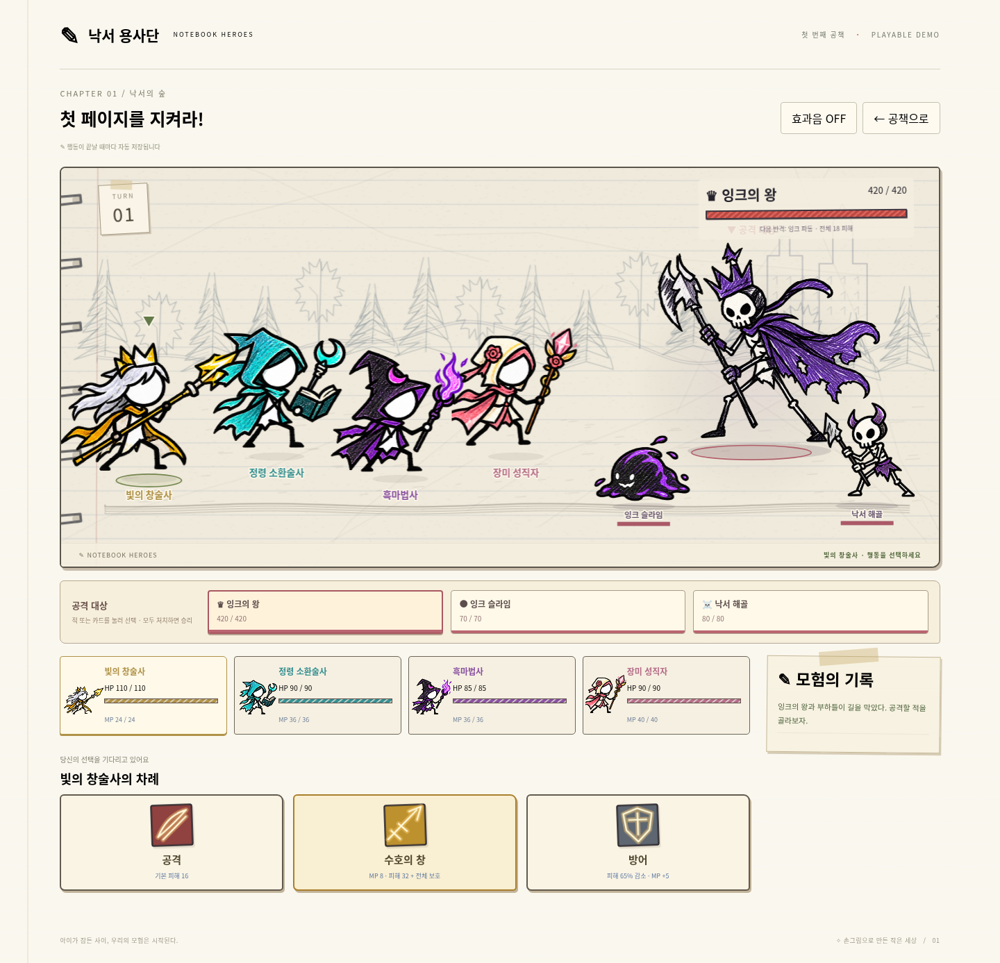

# 낙서 용사단 · Notebook Heroes

공책 속 용사들의 4인 파티 턴제 전투 데모입니다.

**[게임 ZIP 다운로드](https://github.com/WooooTae/Note_Demo/raw/refs/heads/main/release/Notebook-Heroes.zip)**

압축을 풀고 `Game.html`을 Edge 또는 Chrome으로 여세요. 설치나 인터넷 연결이 필요 없습니다.

## 플레이

- **게임 시작**: 8명의 용사 중 서로 다른 4명을 고르고 모험을 시작합니다.
- **용사단 편성**: 캐릭터 카드를 눌러 추가·해제합니다. 선택한 순서가 행동 순서입니다.
- **이어하기**: 마지막으로 완료한 행동까지 저장된 파티, HP, MP, 각 적의 HP, 선택 대상, 소환수, 턴을 복원합니다.
- 저장 기록이 있을 때 새 모험을 시작하면 덮어쓰기 전에 확인합니다.
- 저장은 브라우저의 로컬 저장소를 사용합니다. 같은 브라우저와 같은 HTML 파일 위치에서 이용하세요. 브라우저 데이터 삭제, 시크릿 모드, 파일 이동 시 기록을 읽지 못할 수 있습니다. 저장이 차단되면 안내가 표시됩니다.

## 용사와 전투

| 용사 | 스킬 | MP |
| --- | --- | --- |
| 불꽃 기사 | 화염 참격: 피해 42 | 8 |
| 푸른 마법사 | 별빛 마법: 피해 48 | 9 |
| 숲의 궁수 | 연속 사격: 피해 40 | 8 |
| 빛의 창술사 | 수호의 창: 피해 32 + 생존 아군 전체 보호 | 8 |
| 장미 성직자 | 장미의 축복: 생존 아군 전체 HP 최대 30 회복 | 10 |
| 그림자 도적 | 그림자 쌍검: 피해 52 | 10 |
| 정령 소환술사 | 별여우 소환: 피해 24 + 라운드 종료 시 피해 18의 지원 공격 3회 | 12 |
| 흑마법사 | 영혼 흡수: 피해 44 + 실제 피해의 절반만큼 자신 회복 | 10 |

기본 공격은 MP를 소비하지 않습니다. 방어는 다음 반격 피해를 65% 줄이고 MP를 5 회복합니다. 생존 아군이 모두 행동하면 살아 있는 적들이 반격하며, 매 3라운드 강한 전체 공격을 사용합니다. 회복은 쓰러진 아군을 부활시키지 않습니다.

보스 잉크의 왕(HP 420) 양옆에 잉크 슬라임(HP 70)과 낙서 해골(HP 80)이 등장합니다. 화면의 적이나 아래 대상 카드를 눌러 공격 대상을 선택하세요. 세 적을 모두 쓰러뜨려야 승리합니다. 별여우는 소환술사가 쓰러지면 사라지며, 재소환하면 지원 횟수가 3회로 갱신됩니다.

이전 버전의 저장 기록은 기존 전투 구성을 유지합니다. 일반 몬스터가 함께 등장하는 전투는 **새 모험**에서 시작하세요.

전투 수치와 보상은 데모용입니다. 장비, 성장, 추가 챕터는 포함하지 않았습니다. 캐릭터는 제공된 기획서의 흰 얼굴·가느다란 팔다리·거친 펜선과 색연필 질감을 참고한 낙서 리소스입니다. 준비 자세, 가속 돌진, 타격 시 80ms 멈춤, 반동, 복귀 및 종이 인형처럼 휘어지는 동작을 Canvas로 표현합니다. 직업마다 화염 검기·별빛 폭발·연속 화살·황금 창격·회복 꽃잎·교차 쌍검·정령 소환진·영혼 흡수 연출을 사용합니다. 체력바는 타격 시점에 갱신되며 실제 턴 저장은 연출 완료 후 실행합니다. 개별 관절을 가진 프레임별 작화 애니메이션은 아닙니다.

## 개발

Node.js 20 이상. 외부 npm 패키지 설치가 필요 없습니다.

```sh
npm start
npm test
```

개발 서버 기본 포트는 3000입니다. `PORT`로 변경할 수 있습니다.
단일 HTML과 ZIP 재생성은 Python 3에서 실행합니다.

```sh
python scripts/export.py
```

결과물: `release/Game.html`, `release/Notebook-Heroes.zip`.

## 전투 화면


